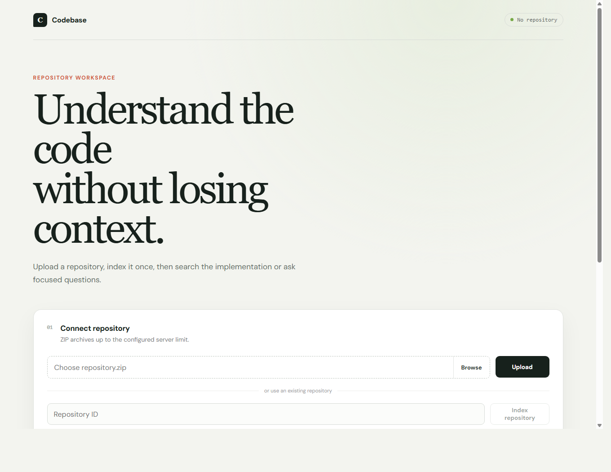
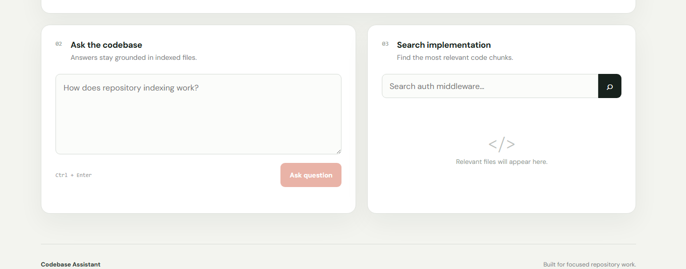
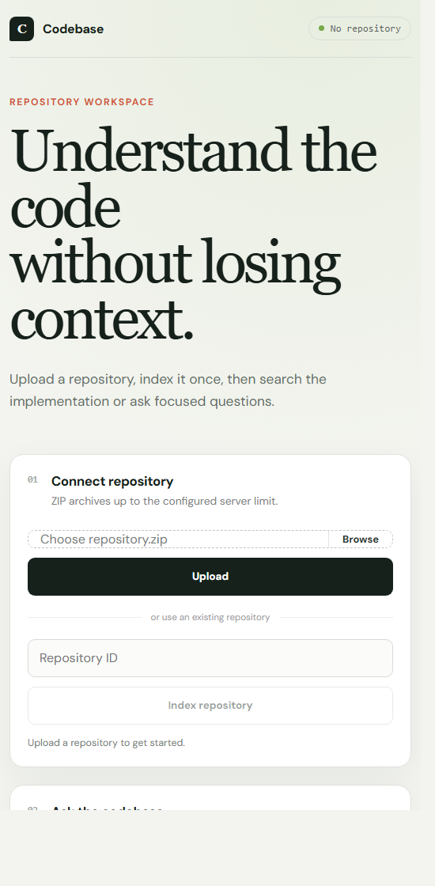

Codebase Assistant using RAG (Retrieval-Augmented Generation)
===========================================================
Overview
--------
This solution implements a .NET 8 backend for a Codebase Assistant. It uploads ZIP repositories, parses and chunks source code, creates OpenAI embeddings, stores vectors in Qdrant, performs repository-scoped semantic search, and answers questions with source citations.

Key projects
------------
- CodebaseAssistant.Api      - ASP.NET Core Web API (controllers and request models)
- CodebaseAssistant.Infrastructure - Implementations, EF persistence, upload service
- CodebaseAssistant.Application - Interfaces and DTOs
- CodebaseAssistant.Domain    - Domain entities and enums
- CodebaseAssistant.Shared    - Shared utilities

Getting started (local)
-----------------------
Prerequisites:
- .NET 8 SDK
- SQL Server (localdb is used by default connection string)
- Qdrant (gRPC endpoint, normally `http://localhost:6334`)
- An OpenAI API key

Configure `OpenAI:ApiKey` and `Qdrant:BaseUrl` using environment variables or .NET user-secrets. Do not commit real keys.

Run API:

1. From solution root:
   dotnet build
   dotnet run --project CodebaseAssistant.Api

2. Apply the database migrations with `dotnet ef database update --project CodebaseAssistant.Infrastructure --startup-project CodebaseAssistant.Api.csproj`.
3. API will run at the configured address and Swagger is available in Development.

Upload repository (sample):

- POST /api/repository/upload
- Form-data: file -> repository.zip

Main workflow:

- `POST /api/repository/upload` — upload a ZIP.
- `POST /api/repository/index/{repositoryId}` — parse, embed, and index it.
- `POST /api/search` — retrieve matching chunks.
- `POST /api/chat/query` — answer a question using retrieved chunks and return citations.

Frontend screenshots
--------------------

### Repository workspace

### Code search and Q&A

### Narrow-screen layout

Files to review
---------------
- PROJECT_STATUS.md  -> project status and roadmap
- GRAPH.MD           -> project structure and discovered files

Security & config
-----------------
- Store API keys and secrets securely (user-secrets or Azure Key Vault).
- Add JWT authentication before exposing non-demo endpoints in production.

License
-------
Proprietary to the current workspace owner. Consult repository owner for licensing.
